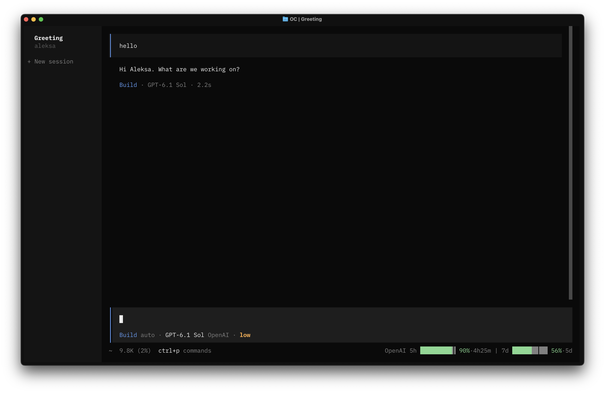
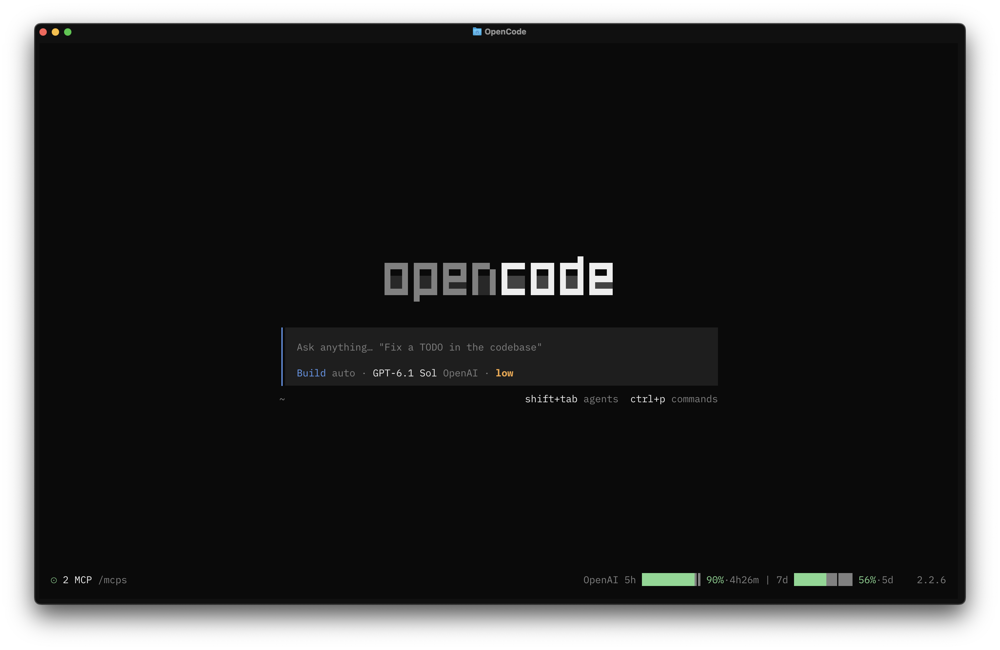

# OpenCode Usage

A small OpenCode V2 TUI plugin showing **remaining 5-hour and weekly (7-day) ChatGPT
quota side by side**, in sessions and on the home screen.
For the terminal interface, not the desktop app.

Based on [opencode-quota](https://github.com/slkiser/opencode-quota). I wanted
both the 5-hour and weekly limits side by side in the status line, a layout I
couldn't get there. This plugin focuses on that: a compact, polished display
without the extra settings, panels, or sidebar space I didn't need.

| Session                                                                | Home                                                                 |
| ---------------------------------------------------------------------- | -------------------------------------------------------------------- |
|  |  |

Percentages, bars, reset countdowns, and a theme-aware pacing marker. Adapts to narrow windows.
**OpenAI ChatGPT only.** Contributions for other providers are welcome.

## Sign in

`/connect` → **OpenAI** → **Codex browser (legacy)** or **Codex device code (legacy)**.

**OAuth is required; API keys are not supported.** Use a legacy Codex login if
the newer “Sign in with ChatGPT” login cannot fetch quota. The plugin accepts
OpenCode's active OAuth credential, but OpenAI decides whether it can access usage.
Uses your OpenCode login, not the Codex CLI. The plugin writes no credentials or
quota data to disk; OpenCode manages stored login credentials.

## Refresh, display, and privacy

- Requests a quota check one second after session execution ends and every five minutes
  while the display is mounted. A 30-second cooldown or error backoff can delay the
  actual request. Replies during the cooldown queue a follow-up check. Countdowns
  update every minute.
- Failed checks keep the last values visible. Retries wait at least five minutes,
  or longer if OpenAI sends a `Retry-After` response.
- Narrow layouts drop bars, then shorten labels. Sessions also drop countdowns,
  then hide quota if both percentages cannot fit.
- Bar markers use the theme's background color and help pace usage until reset.
  Credentials come from OpenCode's integration API; OpenCode handles OAuth refresh.
- OpenAI's usage endpoint is undocumented and may change independently of OpenCode.

## Development

```sh
bun install
bun run typecheck
bun run format:check
bun run build:tui
```

OpenCode loads the package's server and TUI exports through its global plugin
configuration. No publishing or install-time build is required.

**After changing the TUI or shared sources, rebuild and commit `dist/tui.js`.**
The TUI is precompiled with Solid because Git-installed packages live in
`node_modules`, where OpenTUI skips runtime TSX compilation.

No automated test suite is configured. Check rendering and behavior inside the
OpenCode TUI.

[MIT license](./LICENSE).
